# 微博数据采集SDK技术规格书

**版本**: 2.0.0
**状态**: DRAFT
**最后更新**: 2026-02-03
**规范级别**: 类RFC 2119

---

## 文档约定

本文档中的关键词 "MUST"（必须）、"MUST NOT"（禁止）、"REQUIRED"（要求）、"SHALL"（应当）、"SHALL NOT"（不应当）、"SHOULD"（建议）、"SHOULD NOT"（不建议）、"RECOMMENDED"（推荐）、"MAY"（可以）、"OPTIONAL"（可选）按照 [RFC 2119](https://tools.ietf.org/html/rfc2119) 中的描述进行解释。

---

## 1. 架构概述 (Architecture Overview)

### 1.1 设计目标

本SDK旨在提供一个**与语言无关**的技术规格，支持微博平台数据的程序化采集。架构设计参考Rettiwt-API的分层模式，满足以下核心目标：

- **API演化适应性**: 微博API字段频繁变动，SDK MUST提供机制以最小化上游变更对下游消费者的影响。
- **高并发支持**: SDK MUST支持海量数据的分页获取与流式处理。
- **可测试性**: 各层级MUST支持独立测试，无需依赖外部网络IO。
- **多语言可移植性**: 规格定义MUST足够精确，使中级以上工程师能够据此在任何主流编程语言中实现等效功能。
- **开发者体验**: 提供简洁的API接口，支持TypeScript类型推导和自动补全。

### 1.2 系统架构图

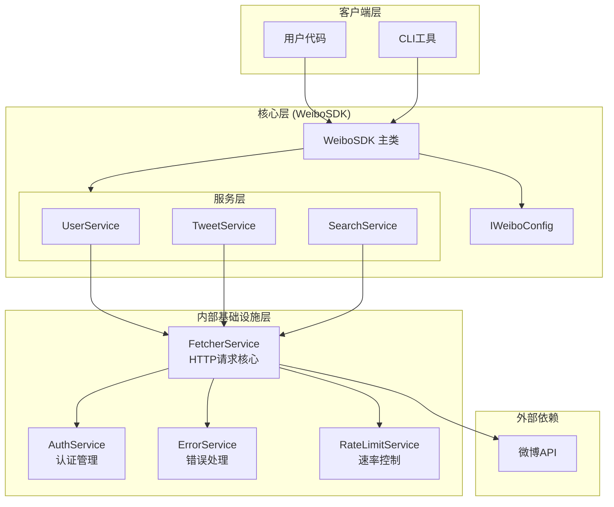

### 1.3 分层架构定义

SDK采用四层分离架构，各层职责边界如下：

| 层级 | 职责 | 关键组件 |
|------|------|----------|
| **客户端层** | 提供程序API和CLI入口 | `WeiboSDK`主类、CLI命令 |
| **服务层** | 按领域划分功能（用户/微博/搜索） | `UserService`, `TweetService`, `SearchService` |
| **基础设施层** | HTTP请求、认证、错误处理、速率控制 | `FetcherService`, `AuthService`, `ErrorService` |
| **数据层** | 原始Schema映射、领域模型转换 | Raw Types, Domain Models |

### 1.4 组件交互图

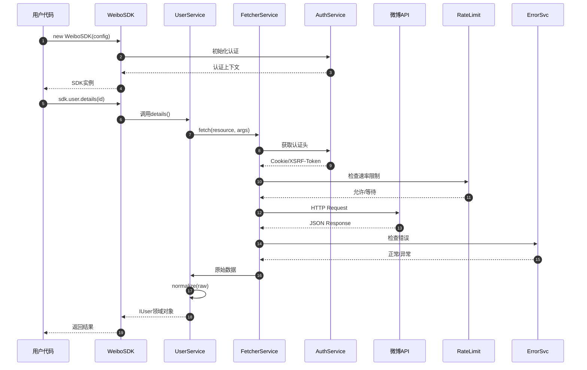

---

## 2. Entity Contracts

### 2.1 领域实体: IUser

`IUser` 是SDK向消费者暴露的用户领域实体，代表经过清洗和标准化的微博用户信息。

#### 2.1.1 字段定义表

| 字段名 | 类型 | 必需 | 描述 | 不变性约束 |
|--------|------|------|------|-----------|
| `id` | `string` | REQUIRED | 用户唯一标识符 | MUST保持全局唯一，MUST NOT为空 |
| `screenName` | `string` | REQUIRED | 用户昵称 | MUST NOT为空 |
| `displayName` | `string` | OPTIONAL | 显示名称（可能含表情） | MAY为null |
| `avatar` | `string` | OPTIONAL | 头像URL | MAY为null |
| `avatarLarge` | `string` | OPTIONAL | 高清头像URL | MAY为null |
| `description` | `string` | OPTIONAL | 个人简介 | 默认值MUST为空字符串 |
| `verified` | `boolean` | REQUIRED | 是否认证用户 | 默认值MUST为false |
| `verifiedType` | `number` | OPTIONAL | 认证类型代码 | MAY为null |
| `verifiedReason` | `string` | OPTIONAL | 认证说明 | MAY为null |
| `followersCount` | `number` | REQUIRED | 粉丝数 | 默认值MUST为0 |
| `followingCount` | `number` | REQUIRED | 关注数 | 默认值MUST为0 |
| `statusesCount` | `number` | REQUIRED | 微博数 | 默认值MUST为0 |
| `profileUrl` | `string` | REQUIRED | 个人主页URL | MUST NOT为空 |
| `location` | `string` | OPTIONAL | 所在地 | MAY为null |
| `gender` | `"m" \| "f" \| "n"` | OPTIONAL | 性别 | 默认值MUST为"n" |
| `createdAt` | `Date` | OPTIONAL | 注册时间 | MAY为null |
| `rawMetadata` | `Record<string, unknown>` | OPTIONAL | 保留的原始扩展字段 | 用于字段演化治理 |

#### 2.1.2 不变性声明 (Invariants)

```
INVARIANT-U1: ∀user ∈ IUser, user.id ≠ undefined ∧ user.id ≠ null ∧ user.id.length > 0
INVARIANT-U2: ∀user ∈ IUser, user.screenName ≠ undefined ∧ user.screenName.length > 0
INVARIANT-U3: ∀user ∈ IUser, user.followersCount ≥ 0 ∧ user.followingCount ≥ 0 ∧ user.statusesCount ≥ 0
INVARIANT-U4: ∀user ∈ IUser, user.profileUrl 包含有效的微博个人主页URL
```

#### 2.1.3 TypeScript接口定义（参考）

```typescript
interface IUser {
  // 核心标识
  id: string
  screenName: string
  displayName?: string | null

  // 头像
  avatar?: string | null
  avatarLarge?: string | null

  // 个人资料
  description: string
  location?: string | null
  gender: 'm' | 'f' | 'n'

  // 认证信息
  verified: boolean
  verifiedType?: number | null
  verifiedReason?: string | null

  // 统计数据
  followersCount: number
  followingCount: number
  statusesCount: number

  // 链接
  profileUrl: string

  // 元数据
  createdAt?: Date | null

  // 扩展字段保留
  rawMetadata?: Record<string, unknown>
}
```

### 2.2 领域实体: ITweet

`ITweet` 是SDK向消费者暴露的微博领域实体。

#### 2.2.1 字段定义表

| 字段名 | 类型 | 必需 | 描述 | 不变性约束 |
|--------|------|------|------|-----------|
| `id` | `string` | REQUIRED | 微博唯一标识符 | MUST保持全局唯一 |
| `mid` | `string` | REQUIRED | 微博MID（Base62编码） | MUST与id一一对应 |
| `content` | `string` | REQUIRED | 微博正文（已清洗HTML） | MUST NOT为undefined |
| `contentRaw` | `string` | OPTIONAL | 原始HTML内容 | MAY为null |
| `author` | `IUser` | REQUIRED | 发布者信息 | MUST包含有效id |
| `createdAt` | `Date` | REQUIRED | 发布时间（UTC） | MUST为有效Date |
| `source` | `string` | OPTIONAL | 发布来源 | MAY为null |
| `metrics` | `IMetrics` | REQUIRED | 互动数据统计 | MUST包含reposts/comments/attitudes |
| `media` | `IMedia[]` | REQUIRED | 媒体资源列表 | 空数组表示无媒体 |
| `isRepost` | `boolean` | REQUIRED | 是否为转发 | MUST为true当且仅当repostOf非空 |
| `repostOf` | `ITweet` | OPTIONAL | 被转发的原微博 | 递归结构 |
| `topics` | `string[]` | REQUIRED | 话题标签列表 | 空数组表示无话题 |
| `mentions` | `string[]` | REQUIRED | @提及的用户ID列表 | 空数组表示无提及 |
| `visibility` | `"public" \| "friend" \| "private"` | REQUIRED | 可见性范围 | 默认值MUST为"public" |
| `rawMetadata` | `Record<string, unknown>` | OPTIONAL | 保留的原始扩展字段 | 用于字段演化治理 |

#### 2.2.2 不变性声明

```
INVARIANT-T1: ∀tweet ∈ ITweet, tweet.id ≠ undefined ∧ tweet.id.length > 0
INVARIANT-T2: ∀tweet ∈ ITweet, tweet.createdAt instanceof Date ∧ !isNaN(tweet.createdAt.getTime())
INVARIANT-T3: ∀tweet ∈ ITweet, tweet.isRepost === true ⟺ tweet.repostOf ≠ null
INVARIANT-T4: ∀tweet ∈ ITweet, tweet.metrics.reposts ≥ 0 ∧ tweet.metrics.comments ≥ 0 ∧ tweet.metrics.attitudes ≥ 0
INVARIANT-T5: ∀tweet ∈ ITweet, Array.isArray(tweet.media) ∧ Array.isArray(tweet.topics) ∧ Array.isArray(tweet.mentions)
```

### 2.3 领域实体: IMedia

| 字段名 | 类型 | 必需 | 描述 |
|--------|------|------|------|
| `id` | `string` | REQUIRED | 媒体资源唯一标识 |
| `type` | `"image" \| "video" \| "gif"` | REQUIRED | 媒体类型 |
| `url` | `string` | REQUIRED | 资源URL |
| `thumbnail` | `string` | OPTIONAL | 缩略图URL |
| `width` | `number` | OPTIONAL | 原始宽度 |
| `height` | `number` | OPTIONAL | 原始高度 |
| `duration` | `number` | OPTIONAL | 视频时长（秒） |

### 2.4 分页数据结构: ICursoredData<T>

```typescript
interface ICursoredData<T> {
  /** 数据项列表 */
  items: T[]

  /** 下一页游标，null表示无更多数据 */
  nextCursor?: string | null

  /** 是否有更多数据 */
  hasMore: boolean

  /** 已获取项目总数 */
  totalFetched: number
}
```

### 2.5 原始Schema: IUserRawResponse

直接镜像映射微博API `/ajax/profile/info` 端点的原始返回结构。

```typescript
interface IUserRawResponse {
```

---

## 3. Interface Definitions

### 3.1 主入口: IWeiboSDK

`IWeiboSDK` 是SDK的主入口类，聚合所有服务。

```typescript
interface IWeiboSDK {
  /** 用户相关操作 */
  readonly user: IUserService

  /** 微博相关操作 */
  readonly tweet: ITweetService

  /** 搜索相关操作 */
  readonly search: ISearchService

  /** 全局配置 */
  readonly config: IWeiboConfig
}

interface IWeiboConfig {
  /** Cookie字符串（必需） */
  cookie: string

  /** XSRF Token（可选，从Cookie自动提取） */
  xsrfToken?: string

  /** 代理URL */
  proxyUrl?: string

  /** 请求超时（毫秒） */
  timeout?: number

  /** 是否启用日志 */
  logging?: boolean

  /** 自定义错误处理器 */
  errorHandler?: IErrorHandler

  /** 请求间隔（毫秒或计算函数） */
  delay?: number | ((retryCount: number) => number)

  /** 最大并发数 */
  maxConcurrent?: number
}
```

### 3.2 用户服务: IUserService

```typescript
interface IUserService {
  /**
   * 获取用户详情
   * @param id 用户ID或昵称
   */
  details: (id: string) => Promise<IUser>

  /**
   * 获取用户时间线
   * @param id 用户ID
   * @param count 每页数量
   * @param cursor 分页游标
   */
  timeline: (
    id: string,
    count?: number,
    cursor?: string
  ) => Promise<ICursoredData<ITweet>>

  /**
   * 获取用户粉丝列表
   * @param id 用户ID
   * @param count 每页数量
   * @param cursor 分页游标
   */
  followers: (
    id: string,
    count?: number,
    cursor?: string
  ) => Promise<ICursoredData<IUser>>

  /**
   * 获取用户关注列表
   * @param id 用户ID
   * @param count 每页数量
   * @param cursor 分页游标
   */
  following: (
    id: string,
    count?: number,
    cursor?: string
  ) => Promise<ICursoredData<IUser>>

  /**
   * 流式获取用户时间线
   * @param id 用户ID
   */
  timelineStream: (id: string) => AsyncIterableIterator<ITweet>
}
```

### 3.3 微博服务: ITweetService

```typescript
interface ITweetService {
  /**
   * 获取单条微博详情
   * @param id 微博ID
   */
  details: (id: string) => Promise<ITweet>

  /**
   * 获取微博评论列表
   * @param id 微博ID
   * @param count 每页数量
   * @param cursor 分页游标
   */
  comments: (
    id: string,
    count?: number,
    cursor?: string
  ) => Promise<ICursoredData<ITweet>>

  /**
   * 获取微博转发列表
   * @param id 微博ID
   * @param count 每页数量
   * @param cursor 分页游标
   */
  reposts: (
    id: string,
    count?: number,
    cursor?: string
  ) => Promise<ICursoredData<ITweet>>
}
```

### 3.4 搜索服务: ISearchService

```typescript
interface ISearchService {
  /**
   * 搜索微博
   * @param query 搜索关键词
   * @param type 搜索类型
   * @param count 每页数量
   * @param cursor 分页游标
   */
  tweets: (
    query: string,
    type?: 'comprehensive' | 'realtime' | 'hot',
    count?: number,
    cursor?: string
  ) => Promise<ICursoredData<ITweet>>

  /**
   * 搜索用户
   * @param query 搜索关键词
   * @param count 每页数量
   * @param cursor 分页游标
   */
  users: (
    query: string,
    count?: number,
    cursor?: string
  ) => Promise<ICursoredData<IUser>>
}
```

### 3.5 核心HTTP服务: IFetcherService

```typescript
interface IFetcherService {
  /**
   * 执行HTTP请求
   * @param resource 请求资源定义
   * @param args 请求参数
   */
  fetch: <T>(
    resource: IRequestResource,
    args?: Record<string, unknown>
  ) => Promise<T>

  /**
   * 流式获取分页数据
   * @param resource 请求资源定义
   * @param args 请求参数
   * @param cursorExtractor 游标提取函数
   */
  fetchStream: <T>(
    resource: IRequestResource,
    args: Record<string, unknown>,
    cursorExtractor: (response: unknown) => string | null
  ) => AsyncIterableIterator<T>
}

interface IRequestResource {
  /** 请求方法 */
  method: 'GET' | 'POST'

  /** 请求URL */
  url: string

  /** 请求头（可选，会合并认证头） */
  headers?: Record<string, string>

  /** 是否需要认证 */
  authenticated?: boolean
}
```

### 3.6 认证服务: IAuthService

```typescript
interface IAuthService {
  /**
   * 获取认证头
   */
  getAuthHeaders: () => Promise<Record<string, string>>

  /**
   * 检查认证是否有效
   */
  validate: () => Promise<boolean>

  /**
   * 刷新认证凭证
   */
  refresh: () => Promise<void>
}
```

### 3.7 错误处理: IErrorHandler

```typescript
interface IErrorHandler {
  /**
   * 处理错误
   * @param error 原始错误
   * @param context 请求上下文
   */
  handle: (
    error: Error,
    context: IRequestContext
  ) => Promise<ErrorHandlingResult>
}

type ErrorHandlingResult
  = | { action: 'retry', delayMs: number }
    | { action: 'fail', error: WeiboSDKError }
    | { action: 'skip', reason: string }

interface IRequestContext {
  url: string
  method: string
  retryCount: number
}
```

---

## 4. 数据流与请求生命周期

### 4.1 请求生命周期状态图

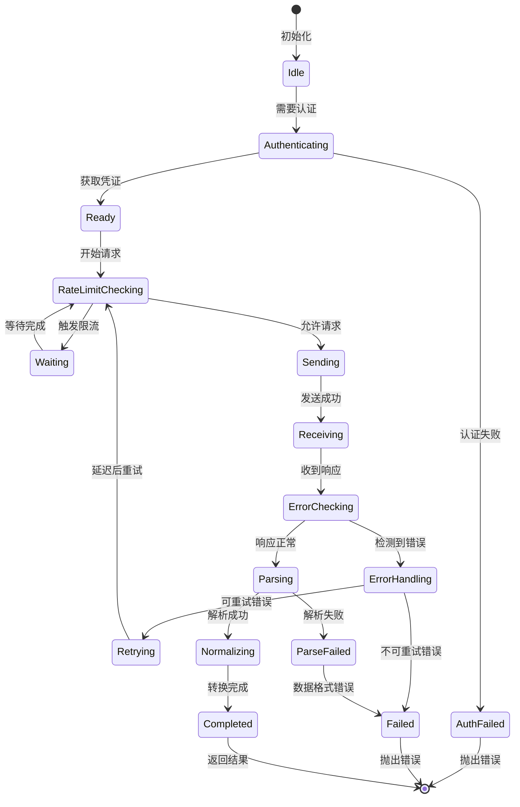

### 4.2 数据转换流程

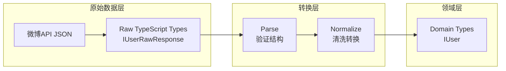

### 4.3 分页数据流

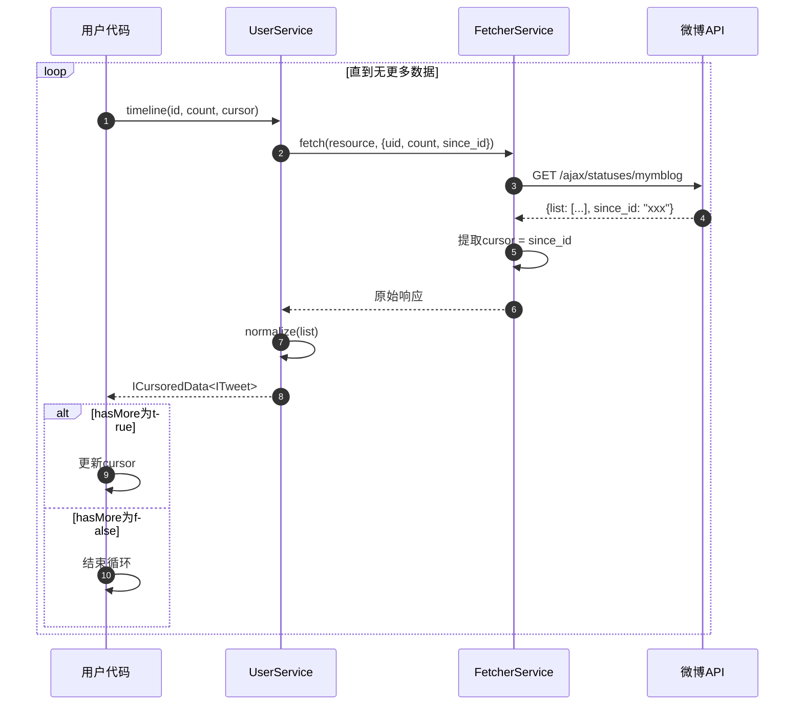

### 4.4 流式数据获取

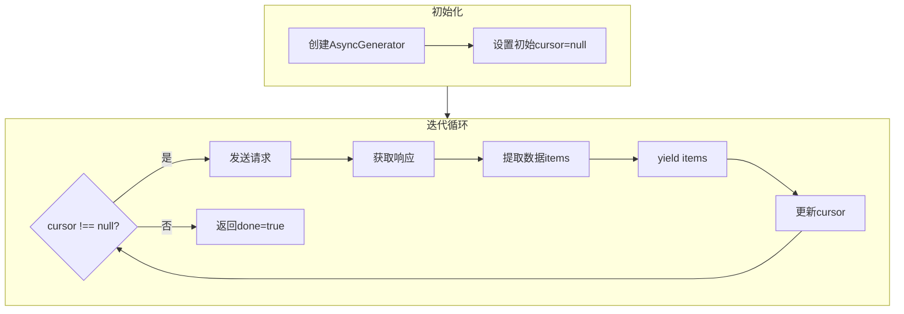

---

## 5. 错误处理矩阵

### 5.1 异常层次结构

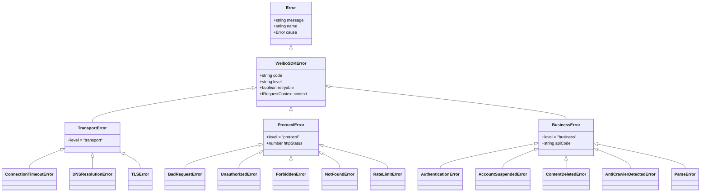

### 5.2 错误映射表

| 错误代码 | 错误类 | 级别 | 可重试 | 触发条件 | 处理建议 |
|----------|--------|------|--------|----------|----------|
| `NET_TIMEOUT` | `ConnectionTimeoutError` | transport | true | 连接超时 | 指数退避重试 |
| `NET_DNS` | `DNSResolutionError` | transport | true | DNS解析失败 | 延迟后重试 |
| `NET_TLS` | `TLSError` | transport | false | TLS握手失败 | 立即失败 |
| `HTTP_400` | `BadRequestError` | protocol | false | 请求参数错误 | 检查参数 |
| `HTTP_401` | `UnauthorizedError` | protocol | false | Cookie失效 | 刷新认证 |
| `HTTP_403` | `ForbiddenError` | protocol | true | IP被限制 | 切换代理 |
| `HTTP_404` | `NotFoundError` | protocol | false | 资源不存在 | 立即失败 |
| `HTTP_429` | `RateLimitError` | protocol | true | 请求频率过高 | 增加延迟 |
| `HTTP_5xx` | `ServerError` | protocol | true | 服务器错误 | 延迟后重试 |
| `WB_20101` | `AccountSuspendedError` | business | false | 账号异常 | 切换账号 |
| `WB_20102` | `ContentDeletedError` | business | false | 内容已删除 | 跳过该条 |
| `WB_20001` | `AntiCrawlerDetectedError` | business | true | 触发反爬 | 增加延迟+代理 |
| `PARSE_FAIL` | `ParseError` | business | false | 数据解析失败 | 记录原始数据 |

### 5.3 错误处理流程

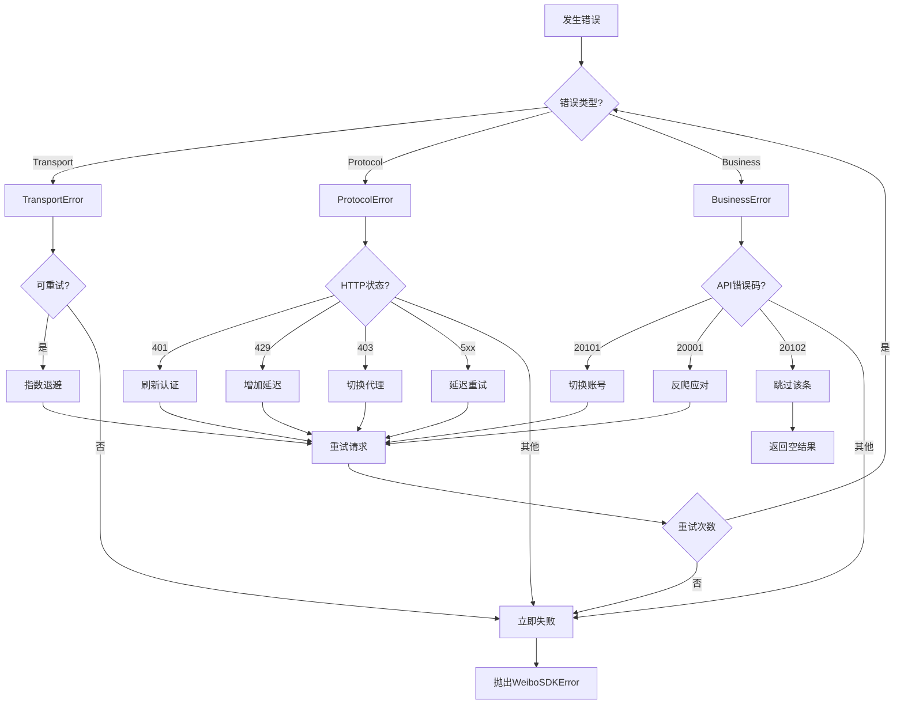

---

## 6. 速率控制与并发管理

### 6.1 速率控制架构

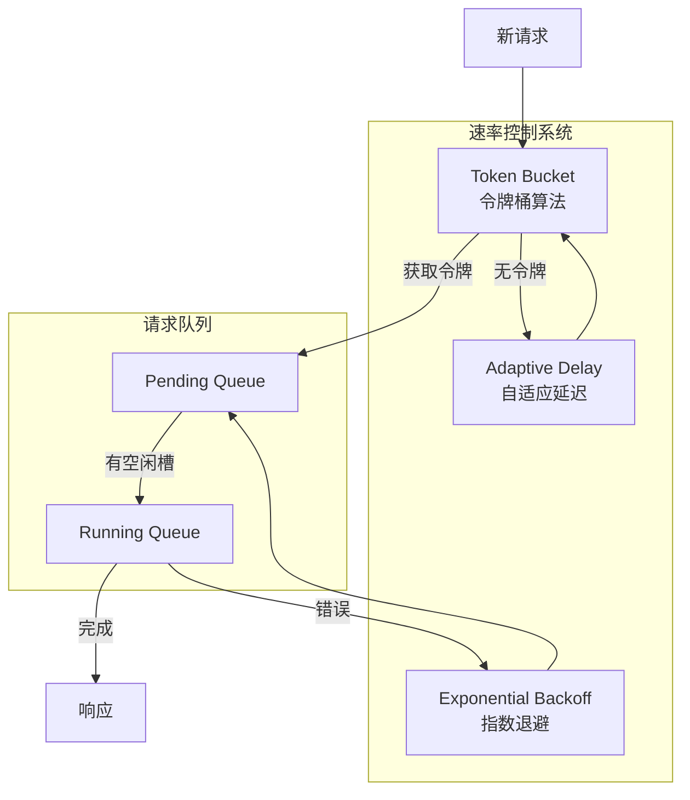

### 6.2 自适应速率控制算法

```
ALGORITHM AdaptiveRateControl:
  INITIALIZE:
    tokens = maxTokens
    lastRefill = now()
    currentDelay = minDelay

  FUNCTION getToken():
    refillTokens()
    IF tokens >= 1:
      tokens -= 1
      RETURN true
    ELSE:
      RETURN false

  FUNCTION refillTokens():
    elapsed = now() - lastRefill
    newTokens = elapsed / refillInterval * maxTokens
    tokens = min(maxTokens, tokens + newTokens)
    lastRefill = now()

  ON success:
    currentDelay = max(minDelay, currentDelay * 0.9)

  ON rateLimitError:
    currentDelay = min(maxDelay, currentDelay * 2)

  ON networkError:
    currentDelay = min(maxDelay, currentDelay * 1.5)
```

### 6.3 并发控制参数

| 参数 | 默认值 | 描述 |
|------|--------|------|
| `maxConcurrent` | 3 | 最大并发请求数 |
| `minDelay` | 1000 | 最小请求间隔（毫秒） |
| `maxDelay` | 30000 | 最大请求间隔（毫秒） |
| `maxRetries` | 3 | 最大重试次数 |
| `backoffMultiplier` | 2 | 退避乘数 |
| `tokenBucketSize` | 10 | 令牌桶容量 |
| `tokenRefillRate` | 1/秒 | 令牌 refill 速率 |

---

## 7. 字段演化治理

### 7.1 扩展字段处理策略

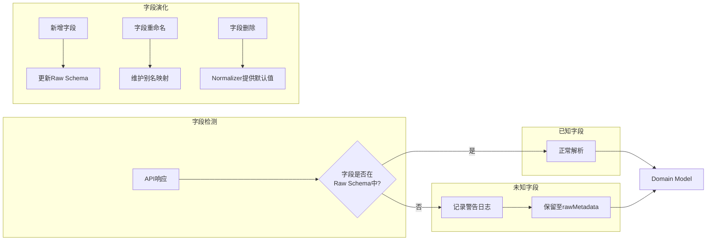

### 7.2 降级处理规则

| 场景 | 处理策略 | 日志级别 |
|------|----------|----------|
| 新增未知字段 | 保留至rawMetadata | WARN |
| 字段重命名 | 别名映射支持新旧名称 | INFO |
| 字段删除 | Normalizer提供默认值 | WARN |
| 类型不匹配 | 尝试强制转换，失败则默认值 | ERROR |
| 无效时间格式 | 使用new Date(0) | WARN |
| 数值为负数 | 取绝对值或设为0 | WARN |

---

## 8. 可测试性约束

### 8.1 测试金字塔

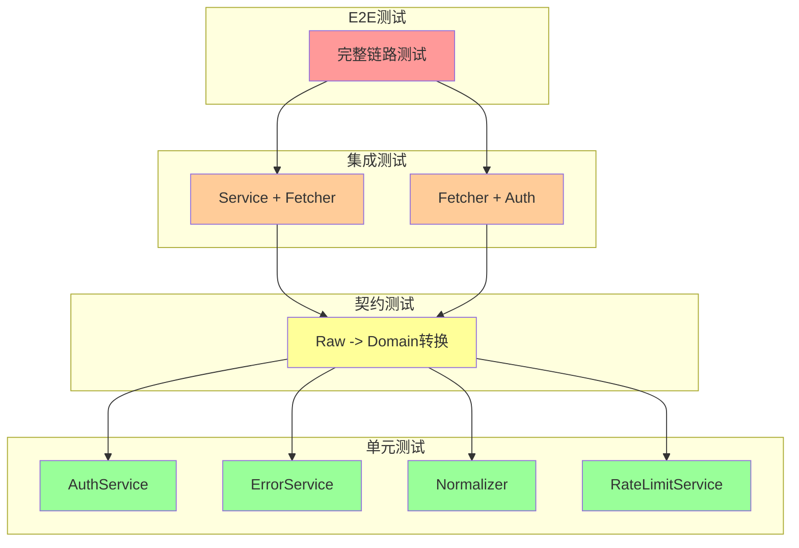

### 8.2 单元测试要求

| 组件 | 测试要求 | 依赖策略 |
|------|----------|----------|
| `AuthService` | 零IO，纯函数测试 | Mock Cookie解析 |
| `ErrorService` | 错误分类逻辑 | 无依赖 |
| `Normalizer` | 数据驱动测试 | 使用fixtures |
| `RateLimitService` | 令牌桶算法 | Mock时间 |
| `FetcherService` | HTTP客户端封装 | Mock axios/fetch |

### 8.3 契约测试数据格式

```typescript
interface IContractTestCase<TInput, TExpected> {
  /** 测试描述 */
  description: string

  /** 输入：原始API响应 */
  input: TInput

  /** 期望输出：领域实体 */
  expected: Partial<TExpected>

  /** 必须满足的不变性 */
  invariants: string[]

  /** 期望的降级行为 */
  expectedDegradations?: {
    field: string
    defaultValue: unknown
  }[]
}

// 示例测试用例
const userTestCases: IContractTestCase<IUserRawResponse, IUser>[] = [
  {
    description: '完整用户数据',
    input: {
      id: 1234567890,
      idstr: '1234567890',
      screen_name: 'testuser',
      verified: true,
      followers_count: 1000,
      friends_count: 500,
      statuses_count: 200
    },
    expected: {
      id: '1234567890',
      screenName: 'testuser',
      verified: true,
      followersCount: 1000,
      followingCount: 500,
      statusesCount: 200
    },
    invariants: ['INVARIANT-U1', 'INVARIANT-U3']
  },
  {
    description: '缺失可选字段',
    input: {
      id: 1234567890,
      idstr: '1234567890',
      screen_name: 'testuser'
      // 缺少verified, followers_count等
    },
    expected: {
      id: '1234567890',
      screenName: 'testuser',
      verified: false,
      followersCount: 0,
      followingCount: 0,
      statusesCount: 0,
      description: ''
    },
    invariants: ['INVARIANT-U1', 'INVARIANT-U3'],
    expectedDegradations: [
      { field: 'verified', defaultValue: false },
      { field: 'followersCount', defaultValue: 0 }
    ]
  }
]
```

---

## 9. 安全与认证

### 9.1 认证流程

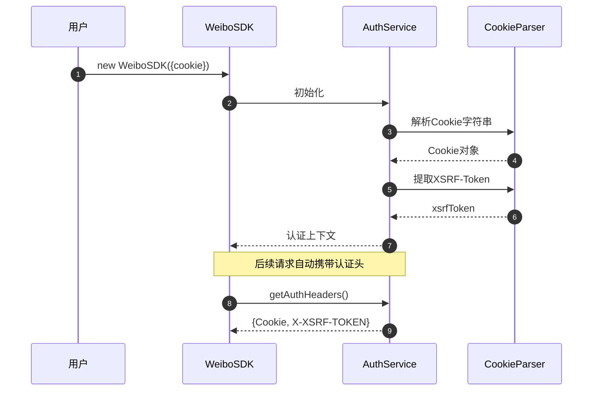

### 9.2 Cookie管理策略

| 策略 | 描述 | 适用场景 |
|------|------|----------|
| `static` | 使用固定Cookie | 短期任务、测试 |
| `rotation` | Cookie池轮询 | 高并发采集 |
| `refresh` | 自动检测过期 | 长时间任务 |

---

## 10. 实现指南

### 10.1 目录结构建议

```
weibo-sdk/
├── src/
│   ├── index.ts                 # 主入口
│   ├── WeiboSDK.ts              # 主类
│   ├── types/
│   │   ├── config.ts            # 配置类型
│   │   ├── errors.ts            # 错误类型
│   │   └── index.ts             # 类型导出
│   ├── services/
│   │   ├── public/
│   │   │   ├── UserService.ts   # 用户服务
│   │   │   ├── TweetService.ts  # 微博服务
│   │   │   └── SearchService.ts # 搜索服务
│   │   └── internal/
│   │       ├── FetcherService.ts    # HTTP核心
│   │       ├── AuthService.ts       # 认证服务
│   │       ├── ErrorService.ts      # 错误处理
│   │       └── RateLimitService.ts  # 速率控制
│   ├── models/
│   │   ├── data/
│   │   │   ├── User.ts          # User领域模型
│   │   │   ├── Tweet.ts         # Tweet领域模型
│   │   │   └── CursoredData.ts  # 分页数据
│   │   └── errors/
│   │       ├── WeiboSDKError.ts # 基类
│   │       ├── TransportError.ts
│   │       ├── ProtocolError.ts
│   │       └── BusinessError.ts
│   ├── types/
│   │   ├── raw/
│   │   │   ├── User.ts          # 用户原始类型
│   │   │   └── Tweet.ts         # 微博原始类型
│   │   └── domain/
│   │       ├── IUser.ts         # 用户领域接口
│   │       └── ITweet.ts        # 微博领域接口
│   └── utils/
│       ├── CookieParser.ts      # Cookie解析
│       ├── Normalizer.ts        # 数据转换
│       └── Logger.ts            # 日志工具
├── tests/
│   ├── fixtures/                # 测试数据
│   ├── unit/                    # 单元测试
│   ├── contract/                # 契约测试
│   └── integration/             # 集成测试
└── package.json
```

### 10.2 语言无关实现原则

| 原则 | 说明 |
|------|------|
| 接口语义一致性 | 所有公共接口的语义MUST与规格书一致 |
| 错误代码一致性 | 错误代码MUST使用规格书中定义的代码 |
| 不变性保证 | 所有声明的不变性MUST在实现中得到保证 |
| 测试覆盖 | 所有接口MUST有对应的单元测试 |

---

## 11. 附录

### 11.1 术语表

| 术语 | 定义 |
|------|------|
| **SDD** | Spec-Driven Development，规格驱动开发 |
| **DTO** | Data Transfer Object，数据传输对象 |
| **Hydration** | 将原始数据转换为领域实体的过程 |
| **Open-ended Schema** | 开放端点模式，允许捕获未定义字段的Schema设计 |
| **Graceful Degradation** | 优雅降级，在部分功能失效时保持核心功能可用的策略 |
| **XSRF Token** | Cross-Site Request Forgery Token，跨站请求伪造防护令牌 |
| **Base62** | 使用62个字符（0-9, a-z, A-Z）的编码方案 |
| **Cursor** | 分页游标，用于获取下一页数据 |
| **AsyncIterator** | 异步迭代器，支持流式数据获取 |

### 11.2 版本历史

| 版本 | 日期 | 变更说明 |
|------|------|----------|
| 1.0.0 | 2026-02-03 | 初始版本 |
| 2.0.0 | 2026-02-03 | 参考Rettiwt-API架构重构，添加mermaid流程图 |

### 11.3 参考文档

- [RFC 2119 - Key words for use in RFCs to Indicate Requirement Levels](https://tools.ietf.org/html/rfc2119)
- [Rettiwt-API Architecture](https://deepwiki.com/Rishikant181/Rettiwt-API/2-architecture)
- 微博API文档（内部）

---

**文档结束**
