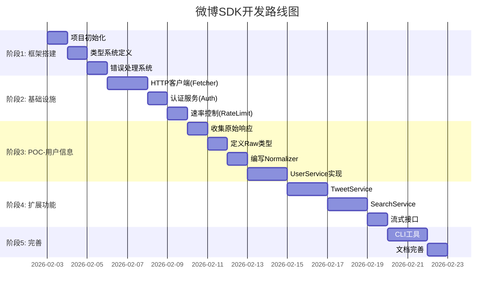

# 微博SDK渐进式开发计划

**版本**: 1.0.0
**最后更新**: 2026-02-03

---

## 开发原则

1. **每一步都是可用的**: 每个阶段完成后，SDK都能执行基本功能
2. **由内向外**: 先构建基础设施，再构建服务层，最后暴露API
3. **测试驱动**: 每个功能都有对应的测试用例
4. **快速反馈**: 早期就能验证核心流程是否可行

---

## 开发路线图



---

## 阶段1: 项目框架搭建 (Day 1-3)

### 1.1 项目初始化

**目标**: 建立项目基础结构，配置开发环境

**产出物**:
```
weibo-sdk/
├── package.json
├── tsconfig.json
├── vitest.config.js
├── .gitignore
└── src/
    └── index.ts
```

**验收标准**:
- [x] TypeScript编译通过
- [x] Vitest 测试框架运行正常
- [x] ESLint配置完成
- [x] 能导出基本模块

**示例代码**:
```typescript
// src/index.ts
export const VERSION = '0.1.0'
console.log('Weibo SDK initialized')
```

### 1.2 类型系统定义

**目标**: 定义核心配置类型和接口契约

**产出物**:
```typescript
// src/types/config.ts
export interface IWeiboConfig {
  cookie: string
  xsrfToken?: string
  proxyUrl?: string
  timeout?: number
  logging?: boolean
  maxConcurrent?: number
  delay?: number | ((retryCount: number) => number)
}

// src/types/index.ts
export * from './config'
```

**验收标准**:
- [x] 所有配置项有类型定义
- [x] 类型导出正确
- [x] 编译无错误

### 1.3 错误处理系统

**目标**: 建立完整的错误层次结构

**产出物**:
```typescript
// src/models/errors/WeiboSDKError.ts
export abstract class WeiboSDKError extends Error {
  abstract readonly code: string
  abstract readonly level: 'transport' | 'protocol' | 'business'
  abstract readonly retryable: boolean

  constructor(
    message: string,
    public readonly context?: Record<string, unknown>
  ) {
    super(message)
    this.name = this.constructor.name
  }
}

// src/models/errors/TransportError.ts
export class ConnectionTimeoutError extends WeiboSDKError {
  readonly code = 'NET_TIMEOUT'
  readonly level = 'transport'
  readonly retryable = true
}

// 其他错误类...
```

**验收标准**:
- [x] 错误类层次结构完整
- [x] 每个错误有正确的code/level/retryable
- [x] 单元测试覆盖所有错误类

**测试示例**:
```typescript
// tests/unit/errors/WeiboSDKError.test.ts
describe('WeiboSDKError', () => {
  it('should have correct properties', () => {
    const error = new ConnectionTimeoutError('timeout')
    expect(error.code).toBe('NET_TIMEOUT')
    expect(error.level).toBe('transport')
    expect(error.retryable).toBe(true)
  })
})
```

---

## 阶段2: 基础设施层 (Day 4-7)

### 2.1 HTTP客户端 (FetcherService)

**目标**: 实现核心HTTP请求功能

**产出物**:
```typescript
// src/services/internal/FetcherService.ts
import axios, { AxiosInstance, AxiosRequestConfig } from 'axios'

export interface IRequestResource {
  method: 'GET' | 'POST'
  url: string
  headers?: Record<string, string>
}

export class FetcherService {
  private client: AxiosInstance

  constructor(private config: IWeiboConfig) {
    this.client = axios.create({
      timeout: config.timeout || 30000,
      proxy: config.proxyUrl ? { host: config.proxyUrl } : false,
    })
  }

  async fetch<T>(
    resource: IRequestResource,
    args?: Record<string, unknown>
  ): Promise<T> {
    const config: AxiosRequestConfig = {
      method: resource.method,
      url: resource.url,
      headers: resource.headers,
      params: args,
    }

    const response = await this.client.request<T>(config)
    return response.data
  }
}
```

**验收标准**:
- [x] 能发送GET/POST请求
- [x] 支持代理配置
- [x] 支持超时配置
- [x] 单元测试覆盖正常/异常场景

**测试示例**:
```typescript
// tests/unit/services/FetcherService.test.ts
describe('FetcherService', () => {
  it('should fetch data successfully', async () => {
    const fetcher = new FetcherService({ cookie: 'test' })
    const mock = nock('https://weibo.com')
      .get('/test')
      .reply(200, { data: 'test' })

    const result = await fetcher.fetch(
      { method: 'GET', url: 'https://weibo.com/test' }
    )

    expect(result).toEqual({ data: 'test' })
  })
})
```

### 2.2 认证服务 (AuthService)

**目标**: 管理Cookie和XSRF-Token

**产出物**:
```typescript
// src/services/internal/AuthService.ts
export class AuthService {
  private cookie: string
  private xsrfToken: string

  constructor(config: IWeiboConfig) {
    this.cookie = config.cookie
    this.xsrfToken = config.xsrfToken || this.extractXsrfToken(config.cookie)
  }

  private extractXsrfToken(cookie: string): string {
    const match = cookie.match(/XSRF-TOKEN=([^;]+)/)
    return match ? match[1] : ''
  }

  getAuthHeaders(): Record<string, string> {
    return {
      'Cookie': this.cookie,
      'X-XSRF-TOKEN': this.xsrfToken,
    }
  }

  validate(): boolean {
    return !!this.cookie && !!this.xsrfToken
  }
}
```

**验收标准**:
- [x] 能从Cookie提取XSRF-Token
- [x] 提供认证头
- [x] 能验证认证有效性
- [x] 单元测试覆盖

### 2.3 速率控制 (RateLimitService)

**目标**: 实现令牌桶算法控制请求速率

**产出物**:
```typescript
// src/services/internal/RateLimitService.ts
export class RateLimitService {
  private tokens: number
  private lastRefill: number

  constructor(
    private maxTokens: number = 10,
    private refillRate: number = 1000 // ms per token
  ) {
    this.tokens = maxTokens
    this.lastRefill = Date.now()
  }

  async acquire(): Promise<void> {
    this.refill()

    if (this.tokens >= 1) {
      this.tokens -= 1
      return
    }

    // 等待令牌
    const waitTime = this.refillRate
    await this.sleep(waitTime)
    return this.acquire()
  }

  private refill(): void {
    const now = Date.now()
    const elapsed = now - this.lastRefill
    const newTokens = Math.floor(elapsed / this.refillRate)

    this.tokens = Math.min(this.maxTokens, this.tokens + newTokens)
    this.lastRefill = now
  }

  private sleep(ms: number): Promise<void> {
    return new Promise(resolve => setTimeout(resolve, ms))
  }
}
```

**验收标准**:
- [x] 令牌桶算法正确实现
- [x] 能控制请求速率
- [x] 单元测试验证限流效果

---

## 阶段3: POC - 获取用户信息 (Day 8-12)

### 3.1 收集原始响应

**目标**: 手动获取微博API原始响应，保存为fixtures

**步骤**:
1. 使用浏览器开发者工具访问微博用户主页
2. 找到 `/ajax/profile/info` 请求
3. 复制响应JSON，保存到fixtures

**产出物**:
```json
// tests/fixtures/raw/user-profile.json
{
  "id": 1234567890,
  "idstr": "1234567890",
  "screen_name": "测试用户",
  "name": "测试用户",
  "profile_image_url": "https://tvax1.sinaimg.cn/...",
  "avatar_large": "https://tvax1.sinaimg.cn/...",
  "description": "这是一个测试用户",
  "verified": true,
  "verified_type": 0,
  "verified_reason": "微博认证",
  "followers_count": 10000,
  "friends_count": 500,
  "statuses_count": 1000,
  "profile_url": "https://weibo.com/u/1234567890",
  "location": "北京",
  "gender": "m",
  "created_at": "Wed Jan 01 00:00:00 +0800 2020"
}
```

**验收标准**:
- [x] 至少收集3个不同用户的响应样本
- [x] 包含完整字段和缺失字段的样本
- [x] 数据脱敏处理

### 3.2 定义Raw类型

**目标**: 根据收集的响应定义TypeScript类型

**产出物**:
```typescript
// src/types/raw/User.ts
export interface IUserRawResponse {
  id: number
  idstr: string
  screen_name: string
  name?: string
  profile_image_url?: string
  avatar_large?: string
  description?: string
  verified?: boolean
  verified_type?: number
  verified_reason?: string
  followers_count?: number
  friends_count?: number
  statuses_count?: number
  profile_url?: string
  location?: string
  gender?: string
  created_at?: string
  [key: string]: unknown
}
```

**验收标准**:
- [x] 类型定义覆盖所有已知字段
- [x] 可选字段标记正确
- [x] 包含扩展字段插槽

### 3.3 编写Normalizer

**目标**: 实现Raw到Domain的转换逻辑

**产出物**:
```typescript
import { IUser } from '../types/domain/IUser'
// src/utils/Normalizer.ts
import { IUserRawResponse } from '../types/raw/User'

export class UserNormalizer {
  static normalize(raw: IUserRawResponse): IUser {
    return {
      id: String(raw.idstr || raw.id),
      screenName: raw.screen_name,
      displayName: raw.name,
      avatar: raw.profile_image_url,
      avatarLarge: raw.avatar_large,
      description: raw.description || '',
      verified: raw.verified || false,
      verifiedType: raw.verified_type,
      verifiedReason: raw.verified_reason,
      followersCount: raw.followers_count || 0,
      followingCount: raw.friends_count || 0,
      statusesCount: raw.statuses_count || 0,
      profileUrl: raw.profile_url || `https://weibo.com/u/${raw.idstr || raw.id}`,
      location: raw.location,
      gender: (raw.gender as 'm' | 'f' | 'n') || 'n',
      createdAt: raw.created_at ? new Date(raw.created_at) : undefined,
      rawMetadata: this.extractUnknownFields(raw),
    }
  }

  private static extractUnknownFields(
    raw: IUserRawResponse
  ): Record<string, unknown> {
    const knownFields = [
      'id',
      'idstr',
      'screen_name',
      'name',
      'profile_image_url',
      'avatar_large',
      'description',
      'verified',
      'verified_type',
      'verified_reason',
      'followers_count',
      'friends_count',
      'statuses_count',
      'profile_url',
      'location',
      'gender',
      'created_at'
    ]

    const unknown: Record<string, unknown> = {}
    for (const key of Object.keys(raw)) {
      if (!knownFields.includes(key)) {
        unknown[key] = raw[key]
      }
    }
    return unknown
  }
}
```

**验收标准**:
- [x] 能正确转换完整数据
- [x] 能处理缺失字段（提供默认值）
- [x] 能提取未知字段到rawMetadata
- [x] 契约测试通过

**契约测试**:
```typescript
// tests/contract/UserNormalizer.test.ts
describe('UserNormalizer', () => {
  const testCases = loadTestCases('user-normalization')

  testCases.forEach((testCase, index) => {
    it(`should normalize case #${index}: ${testCase.description}`, () => {
      const result = UserNormalizer.normalize(testCase.input)
      expect(result).toMatchObject(testCase.expected)

      // 验证不变性
      expect(result.id).toBeTruthy()
      expect(result.followersCount).toBeGreaterThanOrEqual(0)
    })
  })
})
```

### 3.4 实现UserService

**目标**: 实现第一个可用的服务 - 获取用户详情

**产出物**:
```typescript
import { IWeiboConfig } from '../../types/config'
import { IUser } from '../../types/domain/IUser'
import { IUserRawResponse } from '../../types/raw/User'
import { UserNormalizer } from '../../utils/Normalizer'
import { AuthService } from '../internal/AuthService'
// src/services/public/UserService.ts
import { FetcherService } from '../internal/FetcherService'
import { RateLimitService } from '../internal/RateLimitService'

export class UserService {
  private fetcher: FetcherService
  private auth: AuthService
  private rateLimit: RateLimitService

  constructor(config: IWeiboConfig) {
    this.fetcher = new FetcherService(config)
    this.auth = new AuthService(config)
    this.rateLimit = new RateLimitService(
      config.maxConcurrent || 3,
      typeof config.delay === 'number' ? config.delay : 1000
    )
  }

  /**
   * 获取用户详情
   */
  async details(id: string): Promise<IUser> {
    // 速率控制
    await this.rateLimit.acquire()

    // 构建请求
    const resource = {
      method: 'GET' as const,
      url: 'https://weibo.com/ajax/profile/info',
      headers: this.auth.getAuthHeaders(),
    }

    // 发送请求
    const raw = await this.fetcher.fetch<IUserRawResponse>(resource, { uid: id })

    // 转换为领域模型
    return UserNormalizer.normalize(raw)
  }
}
```

**验收标准**:
- [x] 能成功获取用户详情
- [x] 返回正确的IUser对象
- [x] 包含速率控制
- [x] 集成测试通过

**集成测试**:
```typescript
// tests/integration/UserService.test.ts
describe('UserService Integration', () => {
  it('should fetch user details', async () => {
    const service = new UserService({
      cookie: process.env.WEIBO_COOKIE || 'test_cookie',
    })

    // 使用mock或真实API
    const user = await service.details('1234567890')

    expect(user.id).toBe('1234567890')
    expect(user.screenName).toBeDefined()
    expect(user.followersCount).toBeGreaterThanOrEqual(0)
  })
})
```

### 3.5 组装主类 (MVP完成)

**目标**: 组装WeiboSDK主类，完成第一个可用版本

**产出物**:
```typescript
import { UserService } from './services/public/UserService'
// src/WeiboSDK.ts
import { IWeiboConfig } from './types/config'

export class WeiboSDK {
  public readonly user: UserService
  public readonly config: IWeiboConfig

  constructor(config: IWeiboConfig) {
    this.config = config
    this.user = new UserService(config)
  }
}

export * from './models/errors'
export * from './types'
// src/index.ts
export { WeiboSDK } from './WeiboSDK'
```

**使用示例**:
```typescript
import { WeiboSDK } from 'weibo-sdk'

const sdk = new WeiboSDK({
  cookie: 'your_weibo_cookie_here'
})

async function main() {
  const user = await sdk.user.details('1234567890')
  console.log(`用户: ${user.screenName}`)
  console.log(`粉丝: ${user.followersCount}`)
  console.log(`微博: ${user.statusesCount}`)
}

main()
```

**阶段3验收标准**:
- [x] 能成功获取用户详情
- [x] 类型推导正确
- [x] 有完整的测试覆盖
- [x] 有使用示例

---

## 阶段4: 扩展功能 (Day 13-18)

### 4.1 TweetService实现

**目标**: 实现微博相关操作

**功能列表**:
- `details(id: string): Promise<ITweet>` - 获取微博详情
- `comments(id: string, count?, cursor?): Promise<ICursoredData<ITweet>>` - 获取评论
- `reposts(id: string, count?, cursor?): Promise<ICursoredData<ITweet>>` - 获取转发

**产出物**:
```typescript
// src/services/public/TweetService.ts
export class TweetService {
  async details(id: string): Promise<ITweet> {
    // 实现...
  }

  async comments(
    id: string,
    count: number = 20,
    cursor?: string
  ): Promise<ICursoredData<ITweet>> {
    // 实现...
  }
}
```

**验收标准**:
- [x] 能获取微博详情
- [x] 能获取评论列表
- [x] 支持分页

### 4.2 SearchService实现

**目标**: 实现搜索功能

**功能列表**:
- `tweets(query, type?, count?, cursor?)` - 搜索微博
- `users(query, count?, cursor?)` - 搜索用户

**验收标准**:
- [x] 能搜索微博
- [x] 能搜索用户
- [x] 支持分页

### 4.3 流式接口

**目标**: 实现AsyncIterator流式获取

**产出物**:
```typescript
// src/services/public/UserService.ts
async *timelineStream(id: string): AsyncIterableIterator<ITweet> {
  let cursor: string | undefined;

  while (true) {
    const result = await this.timeline(id, 20, cursor);

    for (const tweet of result.items) {
      yield tweet;
    }

    if (!result.hasMore || !result.nextCursor) {
      break;
    }

    cursor = result.nextCursor;
  }
}
```

**使用示例**:
```typescript
// 流式获取用户时间线
for await (const tweet of sdk.user.timelineStream('1234567890')) {
  console.log(`${tweet.author.screenName}: ${tweet.content}`)
}
```

**验收标准**:
- [x] 流式接口正常工作
- [x] 能正确终止
- [x] 支持break/return

---

## 阶段5: 完善与发布 (Day 19-21)

### 5.1 CLI工具

**目标**: 提供命令行接口

**产出物**:
```typescript
// src/cli.ts
#!/usr/bin/env node
import { Command } from 'commander';
import { WeiboSDK } from './WeiboSDK';

const program = new Command();

program
  .name('weibo-sdk')
  .description('微博数据采集SDK CLI')
  .version('0.1.0');

program
  .command('user')
  .description('获取用户信息')
  .argument('<id>', '用户ID')
  .option('-c, --cookie <cookie>', 'Cookie字符串')
  .action(async (id, options) => {
    const sdk = new WeiboSDK({ cookie: options.cookie });
    const user = await sdk.user.details(id);
    console.log(JSON.stringify(user, null, 2));
  });

program.parse();
```

**验收标准**:
- [x] CLI能正确运行
- [x] 支持基本命令
- [x] 输出格式正确

### 5.2 文档完善

**目标**: 完善项目文档

**文档清单**:
- [x] README.md - 项目介绍和快速开始
- [x] API.md - API文档
- [x] CHANGELOG.md - 变更日志
- [x] 代码注释完整

### 5.3 发布准备

**目标**: 准备npm发布

**检查清单**:
- [x] package.json配置正确
- [x] .npmignore配置
- [x] LICENSE文件
- [x] 版本号更新
- [x] CI/CD配置（可选）

---

## 测试策略

### 单元测试覆盖目标

| 模块 | 目标覆盖率 | 关键测试点 |
|------|-----------|-----------|
| Error类 | 100% | 所有错误类型 |
| AuthService | 100% | Cookie解析、Token提取 |
| RateLimitService | 100% | 令牌桶算法 |
| Normalizer | 100% | 契约测试 |
| FetcherService | 80% | HTTP请求、错误处理 |

### 集成测试场景

1. **完整用户详情获取流程**
2. **分页数据获取**
3. **流式数据获取**
4. **错误重试机制**
5. **速率限制效果**

### 契约测试数据

```
tests/fixtures/
├── raw/
│   ├── user-profile-full.json      # 完整用户数据
│   ├── user-profile-minimal.json   # 最小用户数据
│   ├── tweet-detail.json           # 微博详情
│   └── timeline-page.json          # 时间线分页
└── expected/
    ├── user-normalized.json
    └── tweet-normalized.json
```

---

## 风险管理

### 风险识别

| 风险 | 影响 | 缓解措施 |
|------|------|----------|
| 微博API变更 | 高 | 开放Schema设计、rawMetadata保留 |
| 反爬升级 | 高 | 自适应速率控制、代理支持 |
| Cookie失效 | 中 | 清晰的错误提示、自动重试 |
| 类型不匹配 | 中 | 强制类型转换、默认值 |

### 应急预案

1. **API响应结构变更**
   - 立即收集新响应样本
   - 更新Raw类型定义
   - 调整Normalizer逻辑

2. **反爬检测增强**
   - 增加延迟
   - 切换代理
   - 调整User-Agent

---

## 里程碑检查点

### Checkpoint 1: 基础设施完成 (Day 7)
- [ ] FetcherService能发送HTTP请求
- [ ] AuthService能提取认证信息
- [ ] RateLimitService能控制速率
- [ ] 所有基础设施有单元测试

### Checkpoint 2: POC完成 (Day 12)
- [ ] 能获取用户详情
- [ ] 类型推导正确
- [ ] 有使用示例
- [ ] 集成测试通过

### Checkpoint 3: Beta版本 (Day 18)
- [ ] UserService完整
- [ ] TweetService完整
- [ ] SearchService完整
- [ ] 流式接口可用

### Checkpoint 4: 正式发布 (Day 21)
- [ ] CLI工具可用
- [ ] 文档完整
- [ ] 测试覆盖率达标
- [ ] npm包可安装

---
